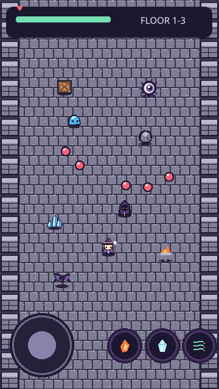
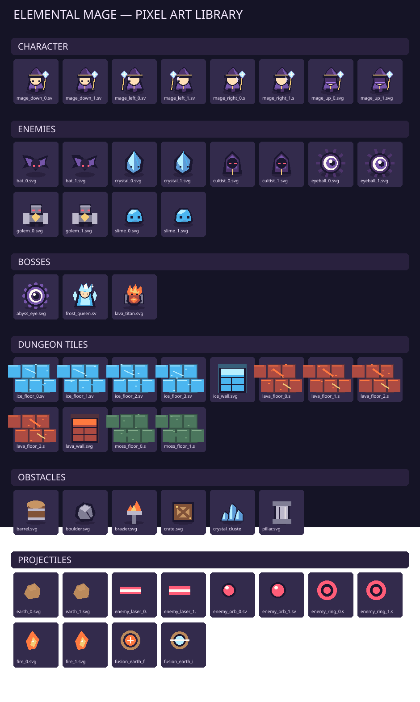

# Elemental Mage / エレメンタルメイジ（仮）

**スマホ縦画面 × 見下ろし型2D × 属性合成 × ローグライト弾幕アクション**

> **ステータス：企画仕様 + オリジナル・スターターアート + ブラウザ試作版。** 完成したゲームやAPKではありません。名称・画風・実装数値は暫定です。



## コンセプト

主人公は魔法使い。ランダムに繋がる部屋を探索し、弾幕を避けながら敵を倒す。属性アイテムは**2個同時装備**でき、それぞれの通常攻撃と**専用の属性合成攻撃**を使える。ボス部屋の直前には必ず**2択の報酬**が現れ、どちらか1個を選択する。

### 基本操作

- 画面左下：半透明のバーチャルジョイスティック。
- 画面右下：属性攻撃1 / 属性攻撃2 / 合成魔法の**3ボタン**。
- 攻撃方向：主人公が向いている方向。ジョイスティックを離しても直前の向きを保持。
- 端末：Android等の縦画面スマートフォンを主対象。最終的なゲームエンジン・APK化方法は未確定。

## 収録内容

| フォルダ | 内容 |
|---|---|
| `docs/GAME_DESIGN.md` | 企画・確定仕様・提案機能・ゲームループ・戦闘・探索・ボス設計 |
| `docs/ART_GUIDE.md` | 色、寸法、透過、アニメーション、当たり判定、今後のアート指針 |
| `docs/TECHNICAL_PLAN.md` | 拡張しやすい実装構造とデータの責務分担 |
| `docs/BACKLOG.md` | 初期版〜APK化までの優先順位と受け入れ条件 |
| `data/*.json` | 無属性＋8属性、合成ペア28組（追加分は一部設計中）、敵11体・ボス3体などのデータ |
| `assets/characters/` | 主人公：上下左右2コマ、RGBA SVG |
| `assets/enemies/` | 雑魚敵6種類×2コマ、RGBA SVG |
| `assets/bosses/` | ボス3種類、RGBA SVG |
| `assets/tiles/` | 4テーマの床バリエーションと壁、32×32px |
| `assets/obstacles/` | 木箱・樽・岩・結晶・柱・燭台、32×32px |
| `assets/projectiles/` | 属性弾・敵弾・合成弾、RGBA SVG |
| `assets/icons/` と `assets/concepts/icons/` | 基本6属性の試作用アイコン、無属性・光・闇を含む9種類のデザイン案 |
| `assets/previews/` | 素材カタログ、画面構成イメージ、ビジュアル構想ボード |
| `tools/generate_art.py` | スターターアートの再生成用Pythonスクリプト |
| `tools/validate.py` | 画像透過・寸法・データ参照の整合性チェック |
| `prototype/` | ブラウザで開ける縦画面の操作・戦闘プロトタイプ |

## 素材一覧



ゲーム用SVGは独立ファイルで収録。プレビューは**最近傍拡大**した表示例です。背景には床タイルを敷き詰め、障害物は透過SVGで重ねます。プレビューは方向性の確認用であり、**実際のゲームのスクリーンショットではありません**。

## ブラウザ試作版

`prototype/index.html` を開くか、ローカルHTTPサーバーでホストします。例：

```bash
cd elemental-mage
python -m http.server 8000
# http://localhost:8000/prototype/
```

画面左側で移動、右側の3つのボタンで攻撃。PCの場合はWASD/矢印キーとJ/K/Lも利用できます。**試作版で実装される要素と、最終仕様の全要素は異なります。** 試作版では最初の属性を炎＋氷に固定し、敵と部屋の動作、合成魔法、選択報酬を確認できます。

## 今後の流れ

1. モバイル端末で操作感と縦画面レイアウトを検証。
2. 弾幕、当たり判定、魔法合成、敵AIをデータ駆動で整理。
3. 部屋生成とボス前2択を含む1周分のプレイを完成。
4. 無属性＋8属性・28組の合成定義・通常／上位敵11体・3ボスを段階的に試作版へ導入。
5. 実機の処理性能・セーブ・サウンド・Android配布方式を整備。

## 重要な区別

- **確定のゲームコンセプト：** 縦画面、魔法使い、見下ろし、ランダム部屋、属性装備2枠、攻撃ボタン3つ、向き依存の射撃、弾幕、複数ボス、ボス前2択、拡張性重視。
- **提案・暫定：** 正式名称、ドット絵の細部、属性・28組の合成効果の細部、各アイテム性能、部屋数、敵数、選択画面の詳細、エンジン、永続強化。

このリポジトリは既存の `radio-roam` 等とは**独立**した新規ゲーム企画として設計しています。
### GitHub登録画像について

このリポジトリには**GitHub向けに描き直した独立SVG素材**を収録しています。先に作成した**オリジナルPNG版と完全に同一の画像ではありません**。元のPNG一式はチャットで配布したプロジェクトZIPに保存されています。

## 新規デザイン案（2026-11）

追加敵5体、無属性＋8属性、ボス3体の差分を**コンセプトアート**として追加しました。

- [追加敵のデザインボード](assets/concepts/boards/new_enemy_concepts.svg)
- [属性アイコン・仕様ボード](assets/concepts/boards/attribute_icons_concepts.svg)
- [ボス差分のデザインボード](assets/concepts/boards/boss_motion_concepts.svg)
- [追加アート仕様と未実装事項](docs/ADDITIONAL_ART_CONCEPTS.md)

個別SVGは `assets/concepts/enemies/`、`assets/concepts/icons/`、`assets/concepts/bosses/` に収録。これらは以前生成したPNG資料とは別のベクター素材です。


## モンスター・ボスのリデザイン素材 v2

追加のデザイン候補は通常・上位敵11体＋ボス3体で、元画像7枚を **112個の透過PNGフレーム**と **14個のアトラス**へ変換する仕様です。

- [素材構成・サイズ・注意事項](docs/SPRITE_PACK_V2.md)
- [4×4元画像を自動分割するPythonスクリプト](tools/split_sprite_sheet_v2.py)
- [GitHub内の画像パケットからPNGとアトラスを生成するスクリプト](tools/materialize_sprite_packets.py)
- [GitHubに登録された候補スプライト](assets/sprites/v2/)

**GitHubで確認済み:** 12体分の復元パケットから、個別透過PNG96枚、アトラス12枚、メタデータ12件を生成して登録。残り2ボス（氷晶の女王・深淵の魔眼）の新リデザインPNGは未登録です。既存の試作用画像は変更していません。生成素材は手作業の品質確認が必要です。


## コンテンツ定義の整合性更新（2026-11-10）

- **ゲーム企画データ:** 無属性＋8属性（雷の内部IDは互換性維持のため `lightning`、`thunder` は表示・外部呼称）、11種の通常・上位敵、3ボス。
- **合成:** 異なる8属性の組み合わせ28組をデータ管理。従来の15組は既存案を維持し、新規13組は確定済みの光×闇以外、効果未決定として記録（実装済みではない）。
- **スプライト:** `data/enemies.json` と `data/bosses.json` の `spriteId` / `spritePack` に新しい候補素材の参照先を保持。実際のPNGについては [v2素材の状態](docs/SPRITE_PACK_V2.md) を確認。
- **互換性:** ブラウザ試作版は従来の6属性を使用する暫定版で、8属性と新モンスターの動作を実装したわけではありません。
