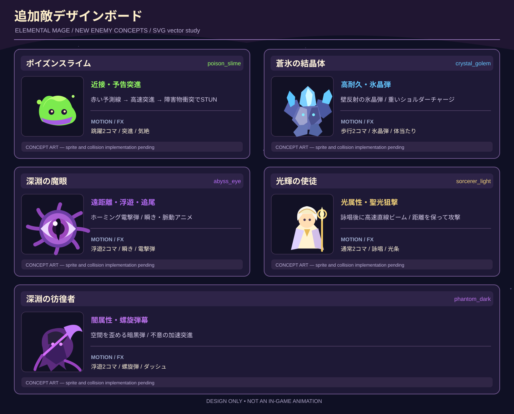
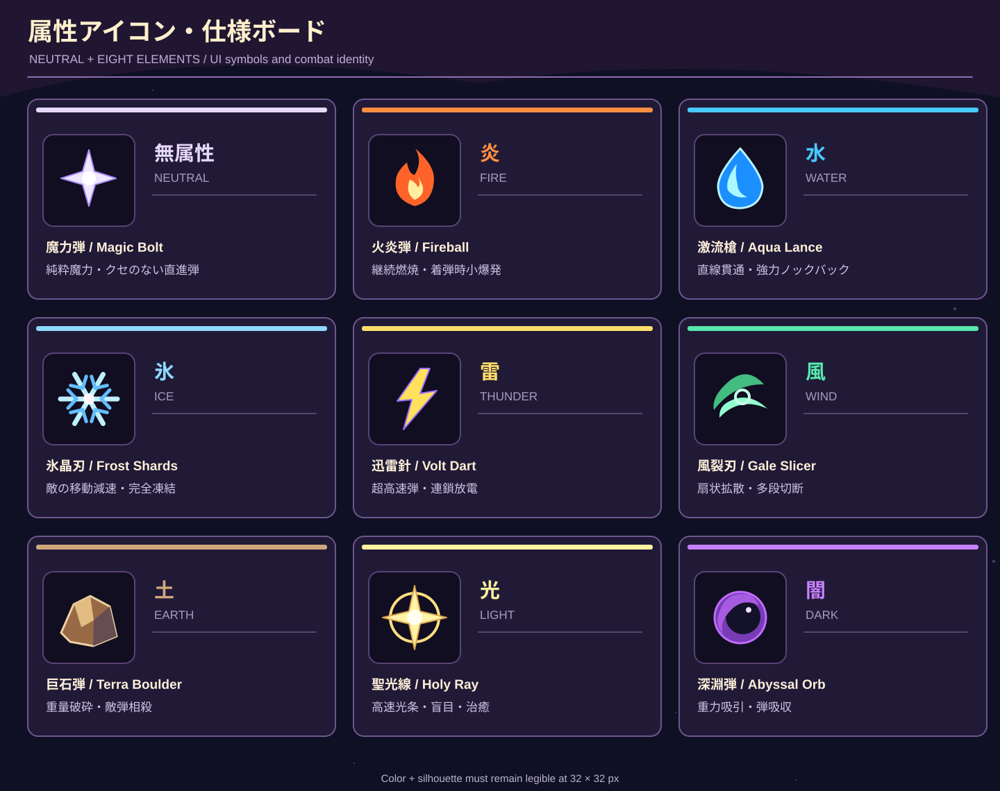
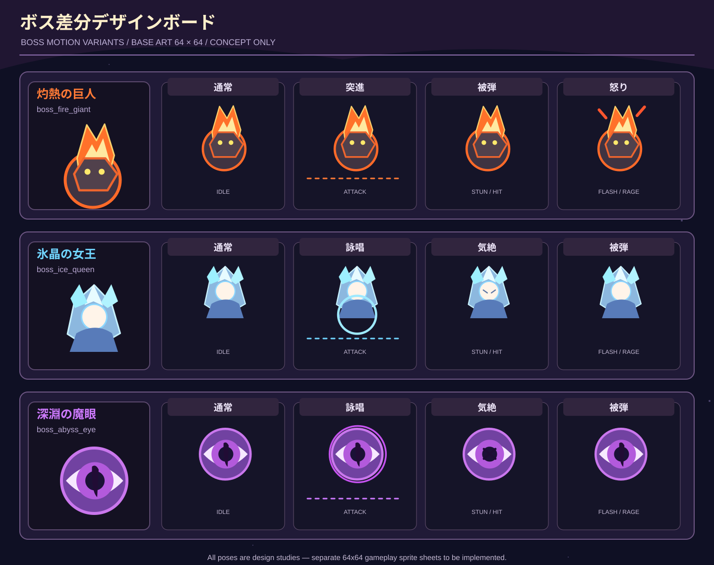

# 追加アート：敵5体・無属性＋8属性・ボス差分

このフォルダには追加コンテンツの**SVG形式のコンセプトアート**を収録しています。前回チャット内で生成した高精細PNG画像とは**別途制作したデザイン案**です。既存のゲーム実装やPNGスプライトを置き換えるものではありません。

## デザインボード

## 追加エネミー

| ID | 名称 | 主な特徴 |
|---|---|---|
| `poison_slime` | ポイズンスライム | 跳ねて接近、赤い予測線、障害物衝突でSTUN |
| `crystal_golem` | 蒼氷の結晶体 | 高耐久・壁反射氷晶弾・体当たり |
| `abyss_eye` | 深淵の魔眼 | 浮遊・追尾電撃弾・瞬き |
| `sorcerer_light` | 光輝の使徒 | 光属性・予告詠唱・高速聖光条 |
| `phantom_dark` | 深淵の彷徨者 | 闇属性・螺旋弾幕・不意の加速突進 |

## 属性

`neutral, fire, water, ice, thunder, wind, earth, light, dark` の合計9種類（無属性＋8属性）。新属性「光」「闇」と既存の6属性は共通のアイコンデザイン原則を適用します。

- 無：魔力弾 / Fire：火炎弾 / Water：激流槍 / Ice：氷晶刃
- Thunder：迅雷針 / Wind：風裂刃 / Earth：巨石弾
- Light：聖光線 / Dark：深淵弾
- 代表シナジー：炎×水「熱蒸気爆衝」2.0倍、炎×氷「熱衝撃破砕」2.2倍、光×闇「虚空特異点」2.5倍

## ボス差分

灼熱の巨人、氷晶の女王、深淵の魔眼にそれぞれ「通常・攻撃（詠唱/突進）・気絶/被弾・怒り/発光」のデザイン案を追加。

## 注意

- **デザインイメージとして追加したもので、すべてのAI・アニメーション・ゲーム内効果が実装済みという意味ではありません。**
- SVGは拡大プレビュー用。アニメーションや実機スプライトへの展開は別工程です。
- 元の仕様書の属性6種類・15組は初期案。今回の8属性を前提に改訂する場合、組み合わせは異なる2属性で28組です。未定義の全組の効果は仮作成しません。
